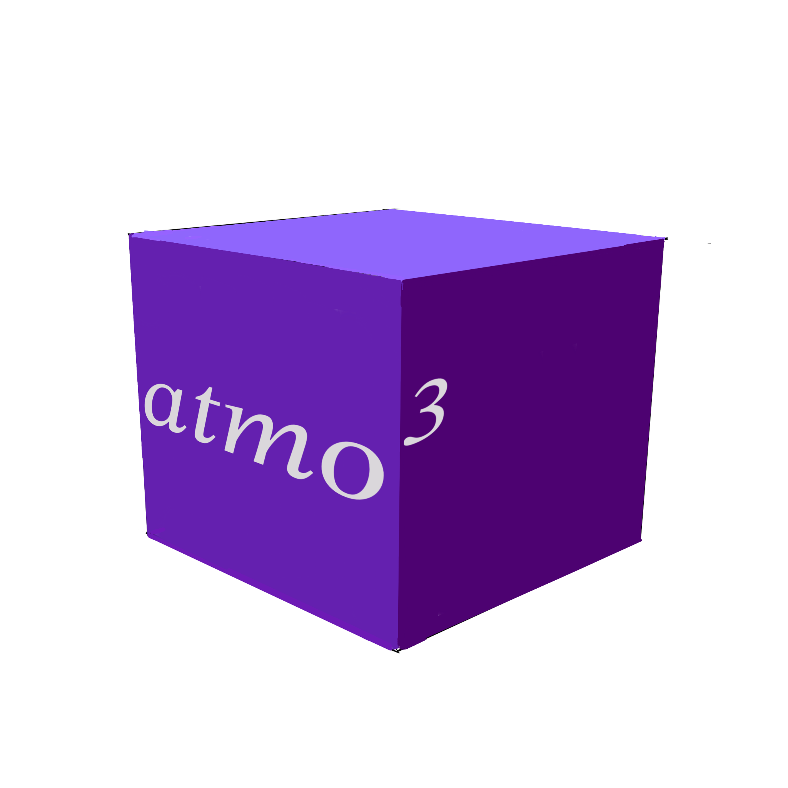

# atmo<sup>3</sup>

Atmo(sphere) cube - a simulation cube for atmospheric emissions in the microwave


### Installation

1. Dependencies: `jax` and `numpy`
2. Clone this git repository: `git clone git@github.com:1cosmologist/atmo3.git`
3. Enter the top level directory: `cd atmo3`
4. Install: `pip install .`


### Usage
The `Atmosphere` is agnostic of the weather-data source: `profiles` is either a
dictionary of measured 1-D profiles (`z` [m], `temperature` [K], `pressure` [Pa],
`specific_humidity` [kg/kg], optional `temperature_std` [K] and
`specific_humidity_std` [kg/kg]), or the name of an
AFGL (1986) reference atmosphere (`'tropical'`, `'midlatitude_summer'`,
`'midlatitude_winter'`, `'subarctic_summer'`, `'subarctic_winter'`,
`'us_standard'`) from `data/afgl_data`:

```python
atmo = a3.Atmosphere(profiles='midlatitude_summer', ...)
# or, equivalently for a user-supplied dict (e.g. from a3.ERA5Handler or a3.afgl_profiles):
atmo = a3.Atmosphere(profiles=a3.afgl_profiles('midlatitude_summer'), ...)
```

The profiles can optionally be recalibrated to the site by passing the mean and
standard deviation of the temperature [K] and the precipitable water vapour [mm]
(`temperature_mean`, `temperature_std`, `pwv_mean`, `pwv_std`). Statistics that
are not given are not calibrated:

```python
atmo = a3.Atmosphere(profiles='midlatitude_summer', temperature_mean=272.2, pwv_mean=1.15, pwv_std=0.03, ...)
```

### Documentation
The documentation is built with Sphinx and the [Shibuya](https://shibuya.lepture.com/) theme (configured for Read the Docs in `.readthedocs.yaml`). To build it locally:

```bash
pip install -r docs/requirements.txt
sphinx-build -b html docs docs/_build/html
```


### Testing
`python ./examples/test_cube.py`
