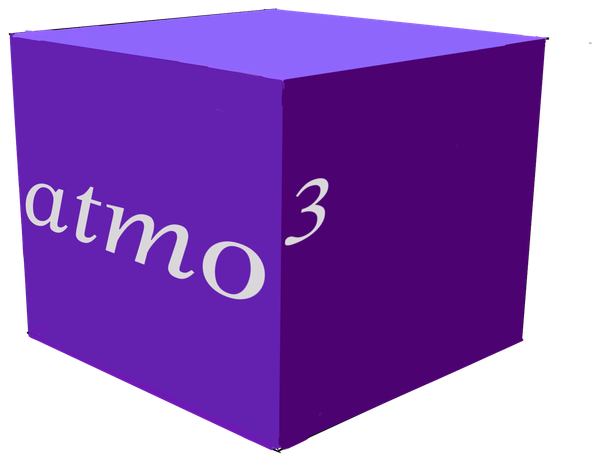

atmo\ :superscript:`3`
=====================

**atmo3** (Atmo\ *sphere* cube) simulates three-dimensional atmospheric
fields (temperature and water vapour, with hooks for clouds and ice) above an
observing site, and computes the millimetre-wave emission seen by a telescope
scanning through them.

.. code-block:: python

   import atmo3 as a3

   atmo = a3.Atmosphere(profiles='midlatitude_summer', site_altitude=5100.)

.. grid:: 1 2 2 3
   :gutter: 3

   .. grid-item-card:: Source-agnostic weather data
      :link: guide/profiles
      :link-type: doc

      The atmosphere is built from plain dictionaries of vertical profiles.
      Use the bundled AFGL reference atmospheres, ERA5 reanalysis, or your own
      measurements.

   .. grid-item-card:: Site calibration
      :link: guide/calibration
      :link-type: doc

      Optionally rescale the mean profiles and the fluctuation amplitudes to
      the temperature and precipitable water vapour measured at the site.

   .. grid-item-card:: Scanning and emission
      :link: guide/observing
      :link-type: doc

      Sample the cube along the lines of sight of a scan, with or without
      wind, and integrate the radiative transfer.

.. toctree::
   :hidden:
   :caption: Getting started

   installation
   quickstart

.. toctree::
   :hidden:
   :caption: User guide

   guide/profiles
   guide/calibration
   guide/grid
   guide/observing

.. toctree::
   :hidden:
   :caption: Reference

   api/index
