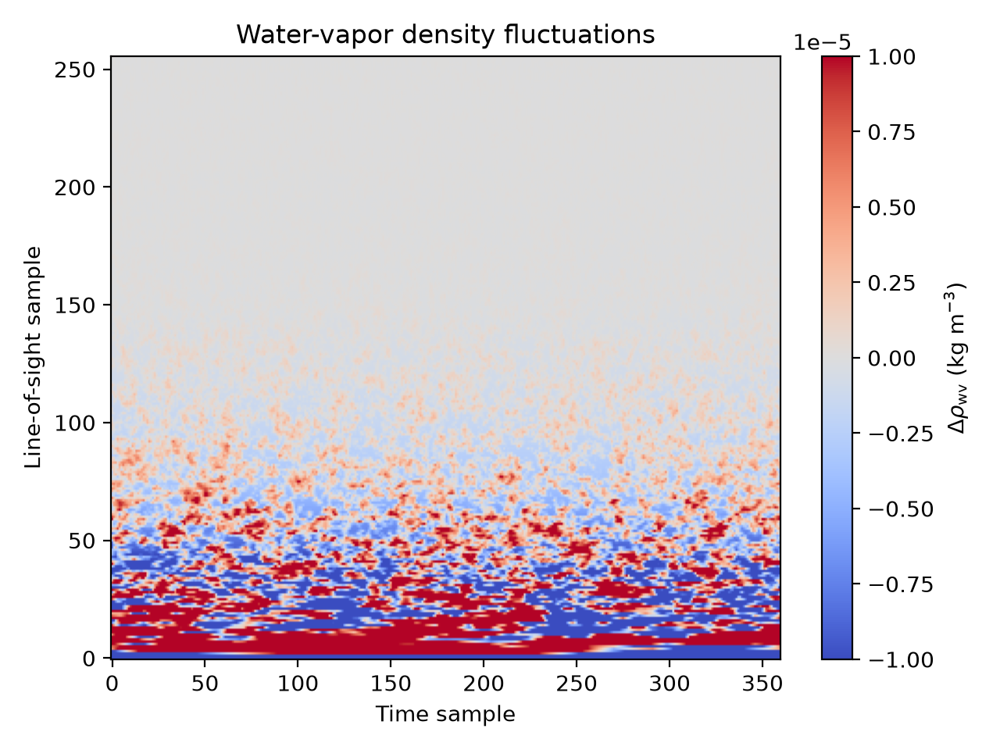
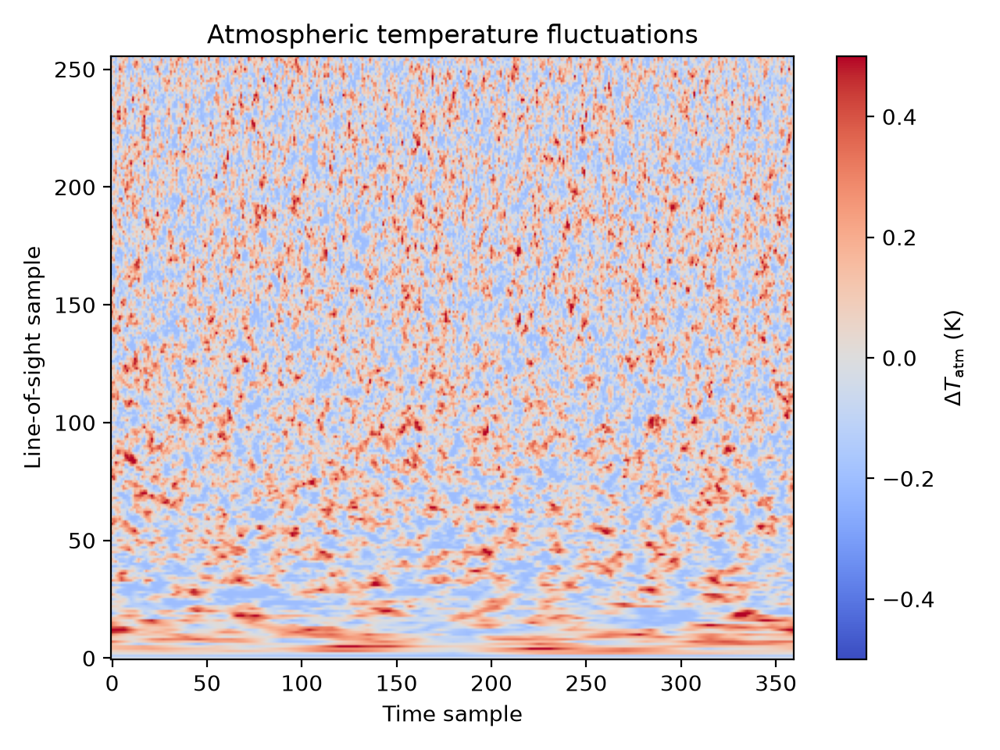
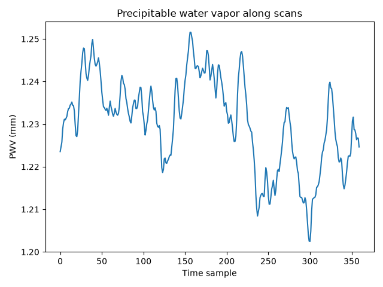
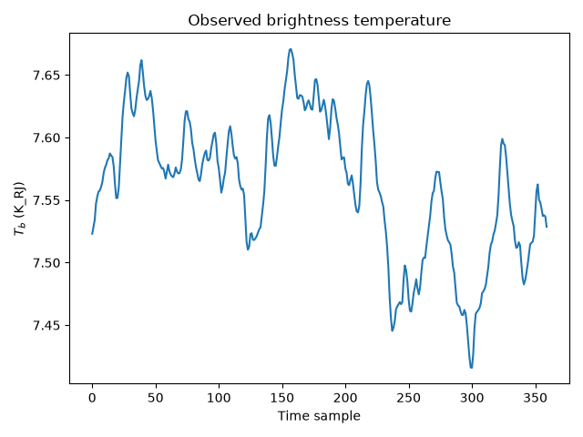

Quickstart
==========

This quickstart walks through the workflow in ``examples/test_box.py``:
configure a simulation, build an atmosphere, add turbulent components, define
a telescope scan, sample the atmosphere, and plot the resulting scans. See
:doc:`installation` to install ``atmo3``. Matplotlib is needed to save the
figures:

.. code-block:: console

   python -m pip install matplotlib
   python examples/test_box.py

The example uses a ``512 x 512 x 256`` grid, so it can require substantial
memory and compute time. Reduce ``nside_grid`` for a smaller test.

1. Set up Python and choose the simulation domain
-------------------------------------------------

The example uses JAX on the CPU, NumPy for scan times, and Matplotlib for
plots. The domain has dimensions ``20 x 20 x 10 km``. The site altitude is in
metres, coordinates are longitude and latitude in degrees, and the observing
epoch is UTC.

.. code-block:: python

   import jax
   jax.config.update('jax_platform_name', 'cpu')
   jax.config.update('jax_platforms', 'cpu')
   # jax.config.update('jax_enable_x64', True)
   import jax.numpy as jnp
   import numpy as np
   from datetime import datetime, timezone
   import matplotlib.pyplot as plt
   from matplotlib.colors import CenteredNorm
   from pathlib import Path
   import atmo3 as a3

   nside_grid = [512, 512, 256]                # [Nx, Ny, Nz]
   box_length = [20000., 20000., 10000.]       # [Lx, Ly, Lz] in m
   boresight = jnp.array([box_length[0] // 2., box_length[1] // 2.])
   passband = {'nu': jnp.array([150.]), 'g(nu)': jnp.array([1.])}  # GHz
   fwhm = 10.                                   # arcmin
   injection_scale_in_m = 500.

   site_altitude = 5190.                        # m
   site_coordinates = [-67.783, -22.95]         # [longitude, latitude] in degrees
   time_utc = datetime(2025, 9, 16, 0, 0, tzinfo=timezone.utc)

2. Build the atmosphere
-----------------------

The ``midlatitude_winter`` profile supplies the mean atmosphere. The example
sets the mean PWV to 1 mm, its fluctuation standard deviation to 0.01 mm, and
the temperature-fluctuation standard deviation to 0.2 K.

.. code-block:: python

   atmo_box = a3.Atmosphere(
       nside_grid=nside_grid,
       box_length_in_m=box_length,
       site_altitude=site_altitude,
       site_coordinates=site_coordinates,
       time_utc=time_utc,
       profiles='midlatitude_winter',
       pwv_mean=1.,         # mm
       pwv_std=0.01,        # mm
       temperature_std=0.2, # K
   )

3. Add turbulent temperature and water vapour
---------------------------------------------

The power spectrum uses a 500 m injection scale and a ``k**(-11/3)`` high-
wavenumber slope. It is normalized to a maximum of one, then used for both
water-vapour and temperature fluctuations.

.. code-block:: python

   k_array = np.arange(max(nside_grid)) * jnp.min(atmo_box.grid_wsp.dk)
   k0 = 2 * np.pi / injection_scale_in_m
   pofk_array = (k0**2 + k_array**2)**(-11 / 6)
   pofk_array /= np.max(pofk_array)
   pspec = {'k': k_array, 'pofk': pofk_array}

   atmo_box.add_watervapor(pspec)
   atmo_box.add_temperature(pspec)

4. Define the scan and observer
-------------------------------

This scan has 360 samples separated by one second. Azimuth advances by one
degree per sample while elevation stays at 55 degrees. The observer uses the
150 GHz passband and a 10 arcmin beam.

.. code-block:: python

   timesamples = [np.datetime64(time_utc)]
   az = [0.]  # degrees
   el = [55.] # degrees

   for sample in range(360 - 1):
       timesamples.append(timesamples[-1] + np.timedelta64(1000, 'ms'))
       az.append(az[-1] + 1.)
       el.append(el[-1])

   obs = a3.Observer(
       grid_wsp=atmo_box.grid_wsp,
       boresight=jnp.array(boresight),
       passband=passband,
       fwhm_arcmin=fwhm,
   )
   obs.compute_los_for_scan(timesamples, az, el)

5. Generate and sample the atmosphere
-------------------------------------

After generating a realization, sample the total water-vapour density and the
water-vapour and temperature fluctuations along each line of sight. The
fluctuation-only scans exclude the mean profiles. Each scan array has shape
``(n_scans, n_los)``. Integrating the **total** water-vapour density along
the path gives PWV in kg m\ :sup:`-2`, numerically equivalent to mm of liquid
water.

.. code-block:: python

   atmo_box.generate_realization(time_step=0)

   rho_wv_scan = obs.scan_atmosphere(atmo_box, component_name='water vapor')
   drho_wv_scan = obs.scan_atmosphere_fluctuation(
       atmo_box, component_name='water vapor'
   )
   dT_atm_scan = obs.scan_atmosphere_fluctuation(
       atmo_box, component_name='temperature'
   )
   pwv_scan = jnp.trapezoid(
       rho_wv_scan, x=obs.los_obj[:, :, 3], axis=1
   )

6. Plot the line-of-sight fluctuations
--------------------------------------

The fluctuation arrays are transposed for ``imshow`` so time samples run
along x and line-of-sight samples along y. The ``coolwarm`` colour map and
zero-centred normalization distinguish positive and negative fluctuations.
The script saves each figure next to ``test_box.py``.

First, plot the water-vapour density fluctuations using a colour scale centred
on zero with a half-range of 10\ :sup:`-5` kg m\ :sup:`-3`:

.. code-block:: python

   drho_wv_scan_np = np.asarray(drho_wv_scan)
   dT_atm_scan_np = np.asarray(dT_atm_scan)
   time_sample = np.arange(len(timesamples))
   los_sample = np.arange(drho_wv_scan_np.shape[1])
   extent = (-0.5, len(time_sample) - 0.5, -0.5, len(los_sample) - 0.5)

   fig, ax = plt.subplots(dpi=200)
   image = ax.imshow(
       drho_wv_scan_np.T, origin='lower', aspect='auto',
       cmap='coolwarm', norm=CenteredNorm(halfrange=1e-5), extent=extent,
   )
   ax.set(xlabel='Time sample', ylabel='Line-of-sight sample',
          title='Water-vapor density fluctuations')
   fig.colorbar(image, ax=ax, label=r'$\Delta\rho_{\mathrm{wv}}$ (kg m$^{-3}$)')
   fig.tight_layout()
   fig.savefig(Path(__file__).resolve().with_name('drho_wv_scan.png'))
   plt.close(fig)

   Water-vapour density fluctuations in kg m\ :sup:`-3`; blue and red
   indicate negative and positive fluctuations, respectively.

Next, plot the temperature fluctuations using a half-range of 0.5 K:

.. code-block:: python

   fig, ax = plt.subplots(dpi=200)
   image = ax.imshow(
       dT_atm_scan_np.T, origin='lower', aspect='auto',
       cmap='coolwarm', norm=CenteredNorm(halfrange=0.5), extent=extent,
   )
   ax.set(xlabel='Time sample', ylabel='Line-of-sight sample',
          title='Atmospheric temperature fluctuations')
   fig.colorbar(image, ax=ax, label=r'$\Delta T_{\mathrm{atm}}$ (K)')
   fig.tight_layout()
   fig.savefig(Path(__file__).resolve().with_name('dT_atm_scan.png'))
   plt.close(fig)

   Atmospheric temperature fluctuations in K, centred on zero.

7. Plot PWV and observed brightness temperature
-----------------------------------------------

Plot the total line-of-sight PWV once per scan sample:

.. code-block:: python

   fig, ax = plt.subplots()
   ax.plot(time_sample, np.asarray(pwv_scan))
   ax.set(xlabel='Time sample', ylabel='PWV (mm)',
          title='Precipitable water vapor along scans')
   fig.tight_layout()
   fig.savefig(Path(__file__).resolve().with_name('pwv_scan.png'))
   plt.close(fig)

   Total water-vapour column along each scan, expressed as liquid-water
   equivalent depth in mm.

``observe_atmosphere`` computes the passband-weighted brightness temperature,
returned in Rayleigh-Jeans kelvin (K\ :sub:`RJ`):

.. code-block:: python

   T_b_obs = obs.observe_atmosphere(atmo_box)
   fig, ax = plt.subplots()
   ax.plot(time_sample, np.asarray(T_b_obs))
   ax.set(xlabel='Time sample', ylabel=r'$T_b$ (K_RJ)',
          title='Observed brightness temperature')
   fig.tight_layout()
   fig.savefig(Path(__file__).resolve().with_name('T_b_obs.png'))
   plt.close(fig)

   Observed brightness temperature at 150 GHz for each scan sample.
